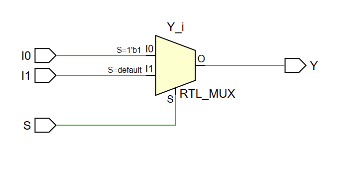
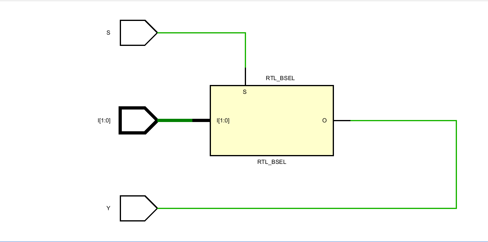
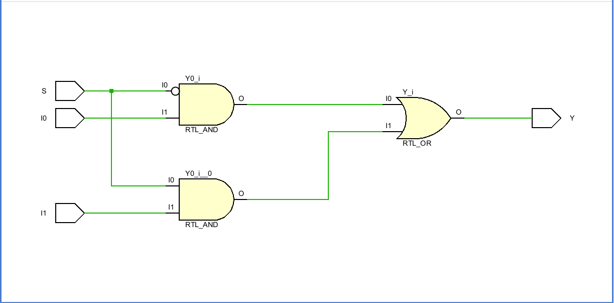
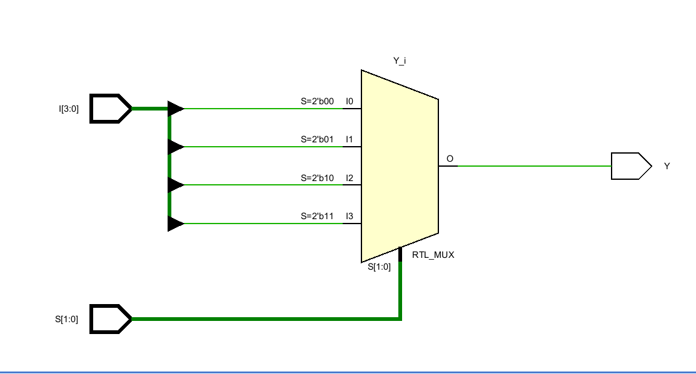
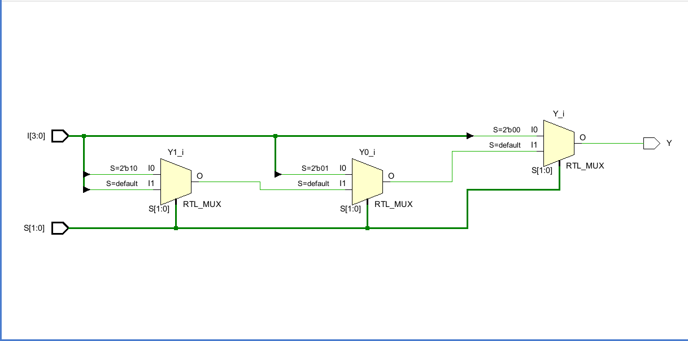
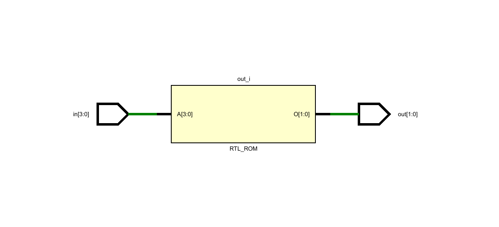

# Practice Verilog

---

## 1) MUX - Using Conditional Statement (continuous assignment)

```verilog
// 1) MUX - using conditional statement
module mux_2_1 (input I0,I1,S, output Y);
assign Y = S ? I1:I0; // If S is 1, out gets true 'I1'; otherwise, out gets 'I0'
endmodule
```

**Schematic:**



---

## 2) MUX - Using If-Else Statement (Procedural block)

```verilog
// 2) MUX - using if else statement
module mux_2_1 (input I0,I1,S, output reg Y);
always @(*) begin
if (S)
 Y =I1;  // imp is must define left hand side Y as reg as its inside always block
else 
 Y =I0; //but structurally implies a priority encode
 end
endmodule
```

**Schematic:**


---

## 3) MUX - Using Case Statement (Procedural block)

```verilog
// 3) MUX - using case statement
module mux_2_1 (input I0,I1,S, output reg Y);
always @ (*) begin
case (S)
 1'b0 : Y = I0;
 1'b1 : Y = I1;
endcase
end
endmodule
```

**Schematic:**


---

## 4) MUX - Using Vector/Array Indexing (continuous or procedural)

```verilog
// 4) MUX - using vector/array indexing (continuous or procedural)
module mux_2_1 (I,S,Y);
input [1:0] I;
input S; // 0 selects I[0], 1 selects I[1]
output Y;
assign Y = I[S];  // The selection bit indexes the array directly to form a MUX
endmodule
```

**Schematic:**



---

## 5) Gate Level / Boolean Logic (Continuous Assignment)

```verilog
// 5) Gate level (Structural / Boolean expression)
module mux_2_1 (input I0,I1,S, output Y);
assign Y = (~S & I0) | (S & I1); // MUX equation in continuous assignment.
// Note: English keywords and, or, not can't be used (e.g. Y = (~S and I0) or (S and I1); is invalid).
// Only bitwise and logical operators (&, &&, |, ||, ~, !) are used in expressions.
endmodule
```

**Schematic:**



---

## N:1 MUX Coding Style Hierarchy / Preference

> **Preference Order:** `Vector Array Index I[S]` > `case` > `Conditional (? :)` > `if-else` > `Structural / Boolean (&, |)`

```verilog
// N*1 mux vector I[S] > case > conditional? > ifelse > structural &
// 1) Vector Array Index (Top Choice):     assign out = in_bus[sel];
// 2) Behavioral case Statement:           always @(*) case(sel) 2'd0: out = in0; ... endcase
// 3) Dataflow Ternary (? :):              nested conditional assignments
// 4) Behavioral if-else Chain:            always @(*) if (sel == 0) out = in0; else if...
// 5) Boolean Logic / Gate-Level (Avoid):  assign out = (~sel[1] & ~sel[0] & in0) | ...
```

### 4:1 MUX Implementation (N:1 Example)

```verilog
module mux_4_1 (I,S,Y);
input [3:0] I;
input [1:0] S;
output reg Y;

// 1) Vector Indexing:
// assign Y = I[S];

// 2) Conditional / Ternary:
// assign Y = (S==2'b00) ? I[0] : (S==2'b01) ? I[1] : (S==2'b10) ? I[2] : I[3];

always @ (*)
// 3) Case Statement:
/* case (S) 
 2'b00 : Y = I[0];
 2'b01 : Y = I[1];
 2'b10 : Y = I[2];
 2'b11 : Y = I[3];
endcase */

// 4) If-Else Chain:
if (S==2'b00)
  Y = I[0];
else if (S==2'b01)
  Y = I[1];
else if (S==2'b10)
  Y = I[2];
else
  Y = I[3];
endmodule
```

**Schematics:**

- **4:1 MUX (Case Statement Schematic):**
  

- **4:1 MUX (Conditional / If-Else Schematic):**
  

---

## Comparison of Verilog MUX Coding Styles (Example: 2:1 MUX)

| Modeling Style | Code Example | Readability | Synthesis / Hardware Output | Best Use Case |
| :--- | :--- | :--- | :--- | :--- |
| **Dataflow (Ternary)** | `assign out = sel ? in1 : in0;` | High | Maps directly to a clean 2:1 MUX macro/cell. | Most common, concise, and standard practice for simple MUXes. |
| **Dataflow (Boolean)** | `assign out = (~sel & in0) \| (sel & in1);` | Low-Medium | Synthesizes to individual AND/OR/NOT logic gates. | Custom logic manipulation or academic exercises. |
| **Behavioral (case)** | `always @(*) case(sel) 1'd0: out = in0; ... endcase` | High | Synthesizes to standard MUX logic (identical to ternary in most tools). | Large multiplexers (4:1, 8:1, 16:1) or clean truth-table mapping. |
| **Behavioral (if-else)** | `always @(*) if(sel) out = in1; else out = in0;` | High | Can accidentally infer priority logic if conditions are incomplete (though clean for simple MUXes). | Control-heavy routing with prioritized conditions. |
| **Gate-Level** | `not n1(s_bar, sel); and a1(w1, in0, s_bar); ...` | Low | Explicitly forces specific gate instantiation. | Legacy design or low-level ASIC/FPGA cell mapping. |

---

## Summary: MUX, DEMUX, Encoder & Decoder Ratios

| Circuit Type | Sizing Ratio | Select Lines | Function |
| :--- | :--- | :--- | :--- |
| **Multiplexer (MUX)** | $2^n : 1$ | $n$ | Selects 1 data input from $2^n$ inputs |
| **Demultiplexer (DEMUX)** | $1 : 2^n$ | $n$ | Routes 1 data input to 1 of $2^n$ outputs |
| **Encoder** | $2^n : n$ | - | Compresses $2^n$ inputs into an $n$-bit binary code |
| **Decoder** | $n : 2^n$ | - | Expands an $n$-bit code into $2^n$ individual output lines |

---

## 6) Demultiplexer (DEMUX 1:2)

### Style A: Behavioral (Bit-Index Overwrite with Latch Prevention)

```verilog
module demux_2_1 (
    input I,
    input S,
    output reg [1:0] Y
);
    // assign Y[S] = I; // Error: S is not constant (variable bit-select on LHS is illegal in continuous assignment)

    always @(*) begin
        Y = 2'b00;  // 1. Add default value to prevent a latch!
        Y[S] = I;   // 2. Overwrite the selected bit
    end
endmodule
```

### Style B: Dataflow (Using Left-Shift `<<`)

```verilog
module demux_2_1 (
    input I,
    input S,
    output [1:0] Y
);
    assign Y = {1'b0, I} << S;  // For 4-bit out (1:4 DEMUX): assign Y = {3'b000, I} << S;
endmodule
```

---

## 7) Decoder (1:2)

### Dataflow (Using Left-Shift `<<`)

```verilog
module decoder_1_2 (
    input I,
    output [1:0] Y
);
    assign Y = 2'b01 << I; // For 2:4 decoder (4-bit out): assign Y = 4'b0001 << I;
endmodule
```

---

## 8) Standard Encoder (4:2) — Using Case Statement

```verilog
// Standard Encoder (Using case) 
module standard_encoder_4_2 (
    input [3:0] in,
    output reg [1:0] out
);
    always @(*) begin
        case (in)
            4'b0001 : out = 2'b00;
            4'b0010 : out = 2'b01;
            4'b0100 : out = 2'b10;
            4'b1000 : out = 2'b11;
            default : out = 2'bxx; // Undefined if multiple inputs or no inputs hit
        endcase
    end
endmodule
```

**Schematic:**



---

## 9) Priority Encoder (4:2) — Using If-Else with Valid Flag

```verilog
// Priority Encoder (Using if-else)
module priority_encoder_4to2 (
    input [3:0] in,
    output reg [1:0] out,
    output reg valid
);
    always @(*) begin
        valid = 1'b1;
        if (in[3])       out = 2'b11; // Highest priority: ignores in[2], in[1], in[0]
        else if (in[2])  out = 2'b10;
        else if (in[1])  out = 2'b01;
        else if (in[0])  out = 2'b00; // Lowest priority
        else begin
            out = 2'b00;
            valid = 1'b0;             // No inputs are active
        end
    end
endmodule
```

> **Why the `valid` flag is needed:**  
> The `valid` flag distinguishes between an active `in[0]` request and no request at all, since both scenarios would otherwise output `2'b00`. It acts as an on/off switch that tells downstream circuits whether the generated output code is meaningful or should be ignored.

---

## 10) Converting a 1-to-4 DEMUX into a 2-to-4 Decoder

To convert a 1-to-4 DEMUX into a 2-to-4 Decoder, pass the main binary inputs into the selection lines and set the data input to a permanent HIGH signal (`1'b1`).

### The Conversion Setup:
- **DEMUX Data Input ($D$)** $\rightarrow$ Tied to `1'b1` (Enable)
- **DEMUX Select Lines ($S_1, S_0$)** $\rightarrow$ Driven by Decoder Inputs ($A$)
- **DEMUX Outputs ($Y_3, Y_2, Y_1, Y_0$)** $\rightarrow$ Become Decoder Outputs ($Y$)

```verilog
// 1-to-4 Demultiplexer Module
module demux_1to4 (
    input D,                 // Data Input
    input [1:0] S,           // Select Lines
    output reg [3:0] Y       // Outputs
);
    always @(*) begin
        Y = 4'b0000;
        Y[S] = D;            // Routes the data bit D to the selected output line
    end
endmodule

// 2-to-4 Decoder implemented USING the DEMUX above
module decoder_2to4 (
    input [1:0] A,           // 2-bit Decoder Input
    output [3:0] Y           // 4-bit Decoder Output
);
    // Tie Data Input (D) to 1'b1 (always enabled)
    // Pass Decoder Input (A) straight into Select lines (S)
    demux_1to4 demux_inst (
        .D(1'b1), 
        .S(A), 
        .Y(Y)
    );
endmodule
```

---